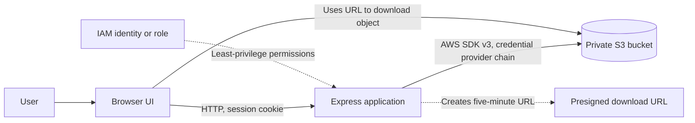

# CloudVault Architecture

CloudVault keeps AWS credentials on the Node.js server. The browser communicates only with the Express API and receives a short-lived presigned URL when a download is requested.

## Request flow

1. The user signs in with the application username and password configured in `.env`.
2. Express creates a session and protects file listing, upload, download-link, and delete routes.
3. The server sends S3 requests through the AWS SDK. Credentials come from the standard AWS credential provider chain.
4. Uploaded objects use server-generated keys under `uploads/` and request SSE-S3 encryption (`AES256`).
5. Downloads use presigned `GetObject` URLs that expire after five minutes. The browser does not receive AWS credentials.

## AWS configuration and trust boundaries

The bucket, Region, and IAM identity are supplied by the person running the application. CloudVault does not create or configure the bucket. Keep Block Public Access enabled and use the least-privilege policy in [`IAM-POLICY-TEMPLATE.json`](IAM-POLICY-TEMPLATE.json), replacing its bucket-name placeholders.

IAM grants `s3:ListBucket` only for the `uploads/` prefix and object read, write, and delete permissions only under that prefix. The health check lists at most one object under `uploads/`; it does not require bucket-wide listing permission.

## Scope

This is a single-user educational application. Its login credentials are shared through local configuration, and Express's default session store keeps sessions in process memory. The app is intended for local demonstration; a public deployment requires HTTPS, a persistent session store, and additional security controls.
